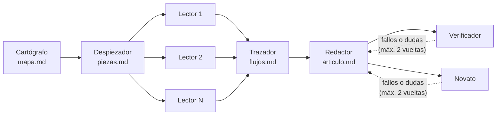

<p align="center">
  
</p>

<h1 align="center">enjambre</h1>

<p align="center">
  <b>Un enjambre de siete agentes Claude que lee un repositorio y escribe el artículo que te habría gustado encontrar en él.</b><br>
  De "no he visto este repo en mi vida" a "me imagino cómo funciona su código", con ficheros y funciones reales, comprobado contra el código.
</p>

<p align="center">
  
  
  
  <a href="LICENSE"></a>
  
  <a href="README.md"></a>
</p>

<p align="center">
  
  <br><i>Repetición de un run real: cada agente en su mesa, qué lee y qué deja.</i>
</p>

> [!TIP]
> **La mejor demo es este mismo repo.** [`articulo.md`](articulo.md) es el artículo que escribió el enjambre sobre su propio código.

## Lo más destacado

- **Siete agentes con rol fijo.** Haiku lee y comprueba; Sonnet decide y redacta. No comparten conversación: cada uno arranca en blanco, lee los ficheros que dejó el anterior y deja el suyo.
- **Ningún LLM dirige el flujo.** El orquestador es Python normal con un orden fijo. Solo mira si el agente terminó bien, si existe el fichero esperado y unos números que saca del Markdown.
- **Los permisos los impone el código, no el prompt.** Un hook `PreToolUse` hace de muro por rol: el redactor nunca ve el repo, el verificador nunca ve las fichas y el novato solo ve el artículo.
- **Se corrige solo.** El verificador comprueba cada fichero, función y ruta que cita el artículo, y el novato apunta lo que no entiende. El redactor corrige, hasta dos vueltas.
- **Lo ves pasar.** Una pantalla en pixel art repite cualquier run o sigue uno en directo (SSE), sin build.
- **Lanzar y olvidarse.** Pegas una URL de GitHub y lo lanzas, o lo encolas para esta noche. Por la mañana el artículo está en tus notas y, si configuras un bot de Telegram, un mensaje te dice cuánto costó.
- **Topes de gasto en todas partes.** Pesar un repo antes de gastar (tamaño, tokens, precio estimado), tope por run en dólares, techo por noche, y un run parado se puede *continuar* sin repetir lo hecho.

## El reparto

<table>
  <tr>
    <td align="center"><br><b>Cartógrafo</b><br><sub>Haiku</sub></td>
    <td align="center"><br><b>Despiezador</b><br><sub>Sonnet</sub></td>
    <td align="center"><br><b>Lectores</b><br><sub>Haiku × N</sub></td>
    <td align="center"><br><b>Trazador</b><br><sub>Sonnet</sub></td>
    <td align="center"><br><b>Redactor</b><br><sub>Sonnet</sub></td>
    <td align="center"><br><b>Verificador</b><br><sub>Haiku</sub></td>
    <td align="center"><br><b>Novato</b><br><sub>Haiku</sub></td>
  </tr>
  <tr>
    <td><sub>Hace el inventario del repo: entrypoints, rutas, servicios, tablas.</sub></td>
    <td><sub>Parte el back en piezas funcionales y decide cuántos lectores se lanzan.</sub></td>
    <td><sub>Uno por pieza, en paralelo. Cada uno escribe la ficha de su pieza.</sub></td>
    <td><sub>Sigue 2–3 flujos de punta a punta a través de las piezas.</sub></td>
    <td><sub>Escribe el artículo solo con las fichas. <b>Nunca ve el repo.</b></sub></td>
    <td><sub>Comprueba cada afirmación contra el código. <b>Nunca ve las fichas.</b></sub></td>
    <td><sub>Lee solo el artículo y apunta lo que da por sabido.</sub></td>
  </tr>
</table>



Un run para cuando el artículo queda aprobado (cero fallos y el novato dice *listo*), o al llegar al tope de vueltas, al tope de gasto o a un fallo de un agente.

## Cómo empezar

Hace falta Python 3.12 y, para runs reales, el [CLI de Claude Code](https://docs.claude.com/en/docs/claude-code) con sesión iniciada (suscripción o clave de API). El modo falso no gasta nada.

```bash
git clone https://github.com/Zell0ss/enjambre-explicador.git
cd enjambre-explicador
python3.12 -m venv .venv && .venv/bin/pip install -r requirements.txt

# Un run falso (sin API ni tokens): cada agente escribe ficheros de pega,
# para ver el flujo entero en la pantalla
.venv/bin/python -m enjambre.orquestar --repo "$PWD" --falso

# La pantalla, en http://127.0.0.1:8790
.venv/bin/python -m enjambre.pantalla
```

Un run real, con tope de 5 $. Antes, pésalo: clona en un temporal y estima el precio sin gastar tokens.

```bash
.venv/bin/python -m enjambre.peso https://github.com/<dueño>/<repo>   # p. ej. 203 ficheros, 2,1 MB · código 499 kB (~124k tokens) · M · 3,5-5 $ · cabe en 5 $
.venv/bin/python -m enjambre.leer https://github.com/<dueño>/<repo> --tope-usd 5
```

`leer` clona (o actualiza) el repo, lanza el enjambre, deja el artículo como nota Markdown y, si Telegram está configurado, avisa.

### Configuración

Opcional. Copia `.env.example` a `.env` y cambia lo que necesites. Manda el entorno, luego el `.env` y luego el valor por defecto.

| Variable | Por defecto | Qué es |
|---|---|---|
| `ENJAMBRE_NOTAS` | `<repo>/notas` | Dónde quedan los artículos. Por ejemplo, una carpeta de tu vault de Obsidian. |
| `ENJAMBRE_COPIAS` | `<repo>/copias` | Dónde se clonan los repos de GitHub. |
| `ENJAMBRE_RAIZ_LOCAL` | `~` | Las rutas locales que le pidas leer tienen que colgar de esta carpeta. |
| `ENJAMBRE_HOST` | `127.0.0.1` | La dirección de la pantalla. `0.0.0.0` se rechaza a propósito. |
| `ENJAMBRE_PUERTO` | `8790` | El puerto de la pantalla. |
| `TELEGRAM_BOT_TOKEN`, `TELEGRAM_CHAT_ID` | vacías | El aviso de la mañana. Sin ellas no se avisa. |

Cada run queda en `salidas/<repo>/<run>/`: los ficheros de cada agente, una carpeta por vuelta de revisión y `eventos.jsonl`, el registro completo que reproduce la pantalla.

## La pantalla

<table>
  <tr>
    <td width="50%"></td>
    <td width="50%"></td>
  </tr>
  <tr>
    <td><sub><b>Portada.</b> Pegas una URL o una ruta y eliges <i>Lanzar ahora</i> o <i>Encolar para esta noche</i>. Debajo, los runs anteriores.</sub></td>
    <td><sub><b>El guardia.</b> Cada llamada denegada enciende su puerta: rojo el muro, ámbar el verificador.</sub></td>
  </tr>
</table>

Es un servidor HTTP con la librería estándar y una sola página HTML, sin build. La repetición y el directo usan el mismo código (el directo es el mismo flujo de eventos por SSE). Un run parado muestra un botón **Continuar** que sigue exactamente donde se quedó.

## Cómo funciona

<details>
<summary><b>¿Por qué roles fijos y sin conversación compartida?</b></summary>

Cada agente recibe un contexto en blanco, su propio prompt y solo los ficheros que puede leer. Así cada paso es barato de repetir, fácil de inspeccionar (todo es Markdown en disco) y difícil de contaminar: el redactor no puede copiar del código, y al novato no le "ayuda" un contexto que un lector de verdad no tendría.
</details>

<details>
<summary><b>El guardia: permisos en código</b></summary>

`enjambre/guardia.py` es un hook `PreToolUse`. Se ejecuta en cada llamada a una herramienta, sea cual sea el modo de permisos, y decide por rol y ruta. El prompt *pide* al agente que no se salga de lo suyo; el hook *se lo impide*. Cada denegado es un evento en la pantalla.
</details>

<details>
<summary><b>Una sola costura con el SDK</b></summary>

Solo `enjambre/lanzador.py` importa `claude_agent_sdk`. Cada agente se lanza aislado: sin la configuración del usuario ni sus servidores MCP (`setting_sources=[]`, `strict_mcp_config`). La idea es portar el enjambre a un modelo local más adelante cambiando una sola función.
</details>

<details>
<summary><b>Decisiones de diseño</b></summary>

El código cita sus decisiones como `D<n>` en la costura que gobiernan (`D8` el guardia, `D22` la mesa de papeles, `D24` continuar un run…). Se tomaron con un flujo arquitecto / programador entre dos sesiones de Claude; en [`docs/plans/`](docs/plans) y [`docs/fase3/`](docs/fase3) están los planes y los informes de cada hito.
</details>

## Estructura

```
enjambre/
  orquestar.py   el guion: orden fijo, condiciones de parada, vueltas, coste
  lanzador.py    el único import de claude_agent_sdk
  guardia.py     el muro de permisos por rol (hook PreToolUse)
  agentes.py     carga las definiciones de los siete agentes
  eventos.py     el registro de eventos (eventos.jsonl)
  pantalla.py    el servidor de la pantalla (repetición + SSE)
  leer.py        URL de GitHub → copia → run → nota → aviso
  peso.py        pesa una fuente y estima su precio antes de gastar
  cola.py        la cola de la noche
pantalla/        la página, la mesa de papeles y los sprites
.claude/agents/  los prompts de los siete agentes
```

Para dejarlo corriendo cada noche en un servidor (timer de systemd, la cola, los avisos) y copiar los prompts a tus notas: [`docs/OPERACION.md`](docs/OPERACION.md).

## Estado

Una prueba de concepto personal para aprender a coordinar un enjambre de agentes. Corre cada noche en mi servidor de casa; todo lo propio de ese servidor está en su `.env`. Explica el back (APIs, servicios, datos), no el front.

## Pruebas

```bash
.venv/bin/pytest -v            # sin red, sin API, sin tokens
node --test tests/js/*.mjs     # la máquina de estados de la pantalla
```

## Licencia

[MIT](LICENSE)
