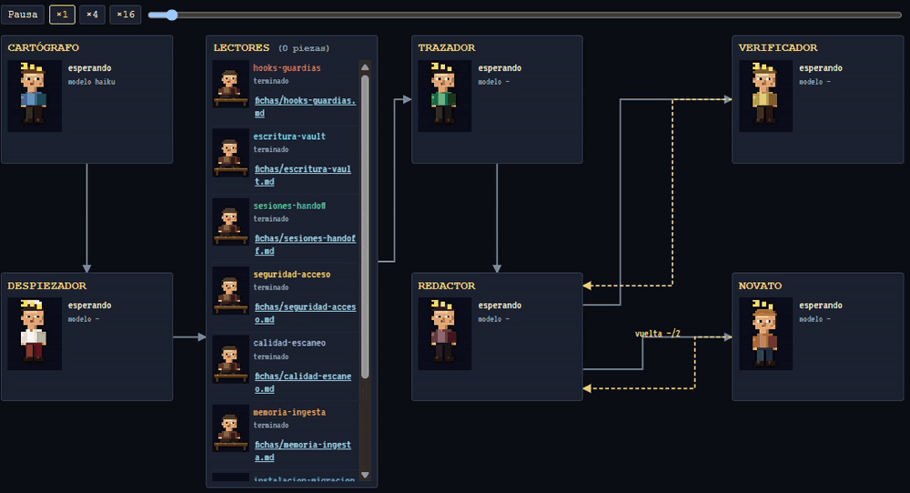
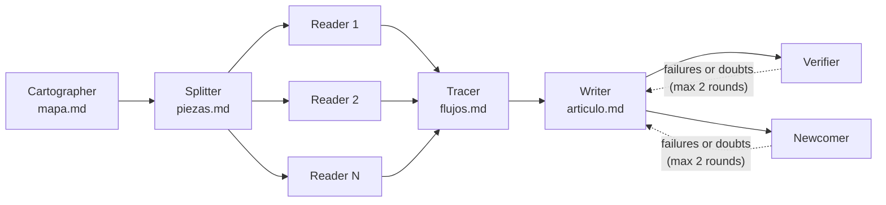
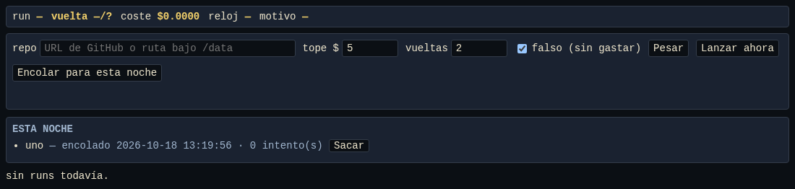
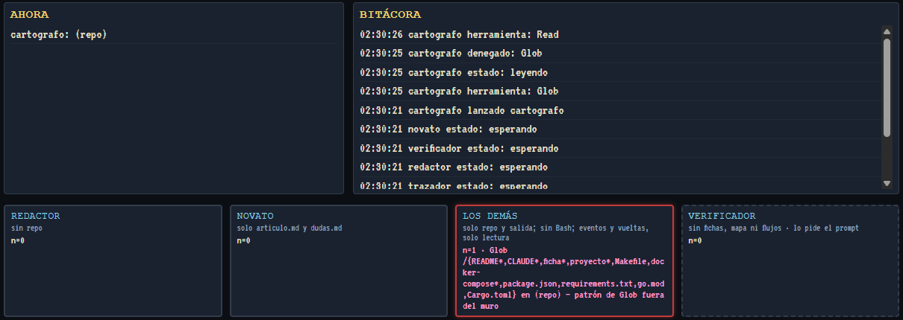

<p align="center">
  
</p>

<h1 align="center">enjambre</h1>

<p align="center">
  <b>A swarm of seven Claude agents that reads a code repository and writes the article you wish it came with.</b><br>
  From "never seen this repo" to "I can picture how its code works", with real files and functions, checked against the code.
</p>

<p align="center">
  
  
  
  <a href="LICENSE"></a>
  
  <a href="README.es.md"></a>
</p>

<p align="center">
  
  <br><i>Replay of a real run: each agent at its desk, what it reads, what it leaves behind.</i>
</p>

> [!TIP]
> **The best demo is this repo itself.** [`articulo.md`](articulo.md) is the article the swarm wrote about its own code.

## Highlights

- **Seven agents with fixed roles.** Haiku reads and checks; Sonnet decides and writes. They share no conversation: each one starts blank, reads the files the previous one left and leaves its own.
- **No LLM drives the flow.** The orchestrator is plain Python with a fixed order. It only looks at exit status, expected files and a few numbers parsed from Markdown.
- **Permissions enforced in code, not in the prompt.** A `PreToolUse` hook is a per-role wall: the writer never sees the repo, the verifier never sees the notes, the newcomer sees only the article.
- **Self-correcting.** A verifier checks every file, function and route the article cites, and a newcomer lists what they don't understand. The writer revises, up to two rounds.
- **You watch it happen.** A pixel-art screen replays any run or follows one live (SSE), with no build step.
- **Fire and forget.** Paste a GitHub URL and launch it, or queue it for tonight. In the morning the article is in your notes and, if you set up a Telegram bot, a message tells you what it cost.
- **Cost caps everywhere.** Weigh a repo before spending (size, tokens, estimated price), a per-run cap in dollars, a nightly ceiling, and a stopped run can be *continued* without redoing finished work.

## The cast

<table>
  <tr>
    <td align="center"><br><b>Cartographer</b><br><sub>Haiku</sub></td>
    <td align="center"><br><b>Splitter</b><br><sub>Sonnet</sub></td>
    <td align="center"><br><b>Piece readers</b><br><sub>Haiku × N</sub></td>
    <td align="center"><br><b>Tracer</b><br><sub>Sonnet</sub></td>
    <td align="center"><br><b>Writer</b><br><sub>Sonnet</sub></td>
    <td align="center"><br><b>Verifier</b><br><sub>Haiku</sub></td>
    <td align="center"><br><b>Newcomer</b><br><sub>Haiku</sub></td>
  </tr>
  <tr>
    <td><sub>Inventories the repo: entrypoints, routes, services, tables.</sub></td>
    <td><sub>Splits the back end into functional pieces and decides how many readers run.</sub></td>
    <td><sub>One per piece, in parallel. Each writes its piece's notes.</sub></td>
    <td><sub>Follows 2–3 flows end to end across the pieces.</sub></td>
    <td><sub>Writes the article from the notes alone. <b>Never sees the repo.</b></sub></td>
    <td><sub>Checks every claim against the code. <b>Never sees the notes.</b></sub></td>
    <td><sub>Reads only the article and lists what it takes for granted.</sub></td>
  </tr>
</table>



A run stops when the article is approved (zero failures and the newcomer says *ready*), or when it hits the round limit, the cost cap or an agent failure.

## Quick start

You need Python 3.12 and, for real runs, the [Claude Code CLI](https://docs.claude.com/en/docs/claude-code) logged in (subscription or API key). Fake mode spends nothing.

The repo never logs in by itself: each agent runs the `claude` CLI bundled with the Agent SDK, which uses whatever this machine already has. That's `ANTHROPIC_API_KEY` if it's set; otherwise the session saved in `~/.claude/` by `claude` → `/login`. Two consequences:

- **If your first real run fails at the cartographer**, check that `claude` is logged in. The real reason is in the `aviso` event of `salidas/<repo>/<run>/eventos.jsonl`.
- **The dollars mean different things.** With an API key, the cap is real money. With a subscription, it's the equivalent cost the SDK reports, and what you actually spend is your usage window. That's why the night queue runs at 02:30 and waits for the session limit to reset.

```bash
git clone https://github.com/Zell0ss/enjambre-explicador.git
cd enjambre-explicador
python3.12 -m venv .venv && .venv/bin/pip install -r requirements.txt

# A fake run (no API, no tokens): every agent writes placeholder files,
# so you can see the whole flow on the screen
.venv/bin/python -m enjambre.orquestar --repo "$PWD" --falso

# The screen, at http://127.0.0.1:8790
.venv/bin/python -m enjambre.pantalla
```

A real run, with a $5 cap. Weigh it first: it clones to a temp folder and estimates the price without spending tokens.

```bash
.venv/bin/python -m enjambre.peso https://github.com/<owner>/<repo>   # e.g. 203 ficheros, 2,1 MB · código 499 kB (~124k tokens) · M · 3,5-5 $ · cabe en 5 $
.venv/bin/python -m enjambre.leer https://github.com/<owner>/<repo> --tope-usd 5
```

`leer` clones (or updates) the repo, runs the swarm, writes the article as a Markdown note and, if Telegram is set up, notifies you.

### Configuration

Optional. Copy `.env.example` to `.env` and change what you need. Precedence: environment > `.env` > default.

| Variable | Default | What it is |
|---|---|---|
| `ENJAMBRE_NOTAS` | `<repo>/notas` | Where the finished articles go. Point it at your Obsidian vault, for instance. |
| `ENJAMBRE_COPIAS` | `<repo>/copias` | Where GitHub repos are cloned. |
| `ENJAMBRE_RAIZ_LOCAL` | `~` | Local paths you ask it to read must be under this folder. |
| `ENJAMBRE_HOST` | `127.0.0.1` | The screen's address. `0.0.0.0` is refused on purpose. |
| `ENJAMBRE_PUERTO` | `8790` | The screen's port. |
| `TELEGRAM_BOT_TOKEN`, `TELEGRAM_CHAT_ID` | empty | Morning notification. Without them, nothing is sent. |

Each run lives in `salidas/<repo>/<run>/`: every agent's files, one folder per review round and `eventos.jsonl`, the full event log the screen replays.

## The screen

<table>
  <tr>
    <td width="50%"></td>
    <td width="50%"></td>
  </tr>
  <tr>
    <td><sub><b>Home.</b> Paste a URL or a path, then <i>Launch now</i> or <i>Queue for tonight</i>. Past runs are listed below.</sub></td>
    <td><sub><b>The guard.</b> Every denied tool call lights up its door: red for the wall, amber for the verifier.</sub></td>
  </tr>
</table>

It is a standard-library HTTP server and one HTML page with no build step. Replays and the live view run the same code (the live view is the same event stream over SSE). A stopped run shows a **Continue** button that picks up exactly where it stopped.

## How it works

<details>
<summary><b>Why fixed roles and no shared conversation?</b></summary>

Each agent gets a blank context, its own prompt and only the files it is allowed to read. That makes every step cheap to rerun, easy to inspect (it is all Markdown on disk) and hard to contaminate: the writer cannot copy from the code, and the newcomer cannot be "helped" by context a real reader won't have.
</details>

<details>
<summary><b>The guard: permissions as code</b></summary>

`enjambre/guardia.py` is a `PreToolUse` hook. It runs on every tool call, whatever the permission mode, and decides by role and path. The prompt *asks* the agent to stay in its lane; the hook *makes* it. Every denial is an event on the screen.
</details>

<details>
<summary><b>One seam to the SDK</b></summary>

Only `enjambre/lanzador.py` imports `claude_agent_sdk`. Each agent is launched isolated: no user settings and no user MCP servers (`setting_sources=[]`, `strict_mcp_config`). The goal is to port the swarm to a local model later by replacing a single function.
</details>

<details>
<summary><b>Design decisions</b></summary>

The code cites its decisions as `D<n>` at the seam they govern (`D8` the guard, `D22` the paper desk, `D24` continuing a run…). They were made in an architect / programmer workflow between two Claude sessions; [`docs/plans/`](docs/plans) and [`docs/fase3/`](docs/fase3) hold the plans and milestone reports.
</details>

## Project layout

```
enjambre/
  orquestar.py   the script: fixed order, stop conditions, rounds, cost
  lanzador.py    the only import of claude_agent_sdk
  guardia.py     per-role permission wall (PreToolUse hook)
  agentes.py     loads the seven agent definitions
  eventos.py     the event log (eventos.jsonl)
  pantalla.py    the screen's server (replay + SSE)
  leer.py        GitHub URL → copy → run → note → notification
  peso.py        weighs a source and estimates its price before spending
  cola.py        the nightly queue
pantalla/        the page, the paper desk and the sprites
.claude/agents/  the seven agent prompts
```

Running it every night on a server (systemd timer, the queue, notifications) and copying the prompts into your notes: see [`docs/OPERACION.md`](docs/OPERACION.md) (in Spanish).

## Status

A personal proof of concept for learning how to coordinate a swarm of agents. It runs every night on my home server; everything specific to that server lives in its `.env`. It explains back ends (APIs, services, data), not front ends. The code, prompts and docs are in Spanish.

## Tests

```bash
.venv/bin/pytest -v            # no network, no API, no tokens
node --test tests/js/*.mjs     # the screen's state machine
```

## License

[MIT](LICENSE)
